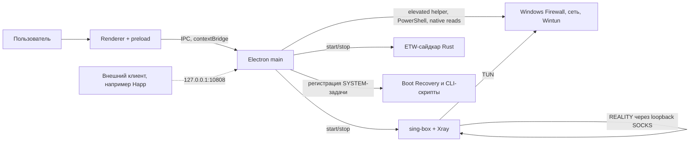

# Обзор и архитектура VPN Tunnel Enforcer

Сводный документ. Заменил 21 файл (`01-обзор`, `03-контейнеры`, `04-компоненты`), которые были выгрузкой из базы знаний Software Factory 8090 от сентября 2026 года; сами файлы сохранены в истории git. Состояние на **2026-10-13** (версия приложения 1.1.24, `main` после PR #26–#39). Нормативными остаются ТЗ в `docs/` и приёмочные тесты `docs/04-приёмочные-тесты/`; этот документ только описывает, что есть и как устроено.

## 1. Продукт

**Проблема.** Пользователи Windows в условиях цензуры и DPI получают частичную защиту: приложения без системного прокси, DNS, IPv6 и WebRTC уходят мимо VPN, а пользователь этого не видит. При сбое ядра, смене сети или выходе из сна трафик на время идёт напрямую; если приложение изменило firewall, DNS или адаптеры и аварийно завершилось, система остаётся без интернета или с наполовину откатанными настройками. Провайдеры блокируют протоколы и серверы, а российские сервисы могут требовать российский IP.

**Решение.** VPN Tunnel Enforcer принудительно направляет весь трафик Windows через TUN-туннель (sing-box + Wintun, для профилей REALITY — Xray), блокирует обходные пути на уровне firewall и адаптеров, восстанавливает защиту после сбоев и даёт инструменты проверки утечек, выбора серверов и маршрутизации. Приложение работает с правами администратора (меняет firewall, маршруты, адаптеры), интерфейс на русском и английском.

**Возможности по группам.** Подключение VPN (ядро, автоперезапуск, адаптивный обход); защита от утечек (WFP kill-switch, блокировка физических адаптеров и IPv6, защита браузеров, Boot Recovery); серверы и подписки (импорт ключей многих форматов, группы, проверка, экспорт); маршрутизация (Smart RU, доменные правила, раздельное туннелирование, DNS-профили); мониторинг (IP, трафик, скорость, доступность сайтов); диагностика (leak self-test, ZIP для поддержки, форензика на ETW); Soft-режим (прокси в окружении, Git, Gradle, Android Studio); автоматизация (расписание, ротация, AutoPilot); внешний локальный прокси с REST API на `127.0.0.1:17873`.

**Персоны.** Обычный пользователь (одна кнопка, понятный статус, автовосстановление, Smart RU); продвинутый (много ключей и протоколов, пакетные проверки, доменные правила, DNS-профили, форензика); разработчик (Soft-режим, раздельное туннелирование, внешний прокси и CLI); пользователь в нестабильной сети (адаптивный обход, ротация, расписание). Будущая персона — несколько аккаунтов в изолированных браузерных профилях (WP-12, не реализовано).

**Метрики (в коде нет формальных, цели не согласованы).** Отсутствие утечек (доля сессий, где самопроверка не нашла выхода через физический адаптер); время восстановления защиты после сбоя; успешность подключения с первой попытки или после автоподбора режима; чистое восстановление системы после выхода/сбоя/перезагрузки; медианное время от «Подключить» до рабочего туннеля (фазы запуска измеряются в коде).

## 2. Технические требования

- Только Windows 10/11 x64, права администратора, установка для всех пользователей. Поддержка Windows 10 завершена Microsoft 14.10.2025, решение о дальнейшей поддержке — явное (ТЗ-06, раздел 10).
- Туннель IPv4-only, IPv6 блокируется. Основной туннель не зависит от внешних сервисов: правила маршрутизации имеют локальные копии, сбой обновления подписки или rule-set его не роняет.
- Любое изменение системной сети имеет откат и проверку результата; после аварийного завершения сеть восстанавливается, в том числе при загрузке Windows задачей от SYSTEM; запущенные процессы не остаются после выхода.
- Ключи и токены — секреты: не попадают в журналы, ZIP и сообщения об ошибках; хранятся через Electron `safeStorage` (DPAPI).
- Renderer не обращается к Windows API, файлам и оболочке напрямую — только через проверенный IPC; API внешнего прокси слушает loopback и требует токен.

## 3. Состояние на 2026-10-13

- **Версии:** приложение 1.1.24, Electron 44.4.3 (миграция с 42 выполнена 2026-09-30), electron-vite 5, electron-builder 26.15.3, sing-box 1.13.13, Node 24.21.0+.
- **CI и ветка `main`:** GitHub Actions на Windows (типы, `npm test`, трассировка AT, ETW-сайдкар на Rust, нативные чтения под Electron), `main` защищён обязательными проверками (PR #29).
- **Аудит:** 210 находок F-001…F-210 в `00-журнал-аудита.md`; исправлены и записаны F-193 (ночные окна), F-010 (несовпадение IP в тесте скорости), F-085 (вердикт 401/403; F-210 — расхождение документации о нём), F-047 (WireGuard как endpoint), F-076 (split tunneling по пути; команды без пути — по имени по решению владельца 2026-10-13, условия б–г ТЗ том 1 §4.3 не реализованы), F-011 частично (счётчики доменных правил за сессию), остаток F-002/F-104 (runtime-каталог через helper). Статус по пакетам — в `06-ТЗ-исправление-и-развитие.md`.
- **Что исправлено ранее (по `progress.md`):** шифрование секретов (SecretRef/DPAPI), доверенная IPC-граница, default-masked экспорт, транзакционный firewall и Boot Recovery, собственная IPv6-политика WFP, controlled shutdown установщика без принудительного завершения, нативные чтения сети в `utilityProcess`.
- **Не реализовано (WP-12, за флагами, в production не включать):** изоляция аккаунтов в браузерных профилях, ядро mihomo через `CoreAdapter`, AmneziaWG, постоянный процессный монитор трафика; также FakeIP, DoQ.
- **Открыто:** подпись кода (ТЗ-06, раздел 10.8); автообновление и контрольные суммы бинарников; живая приёмка пакетов WP на Windows (E2E по AT), включая handshake WireGuard, split tunneling по пути, мастер первого запуска на чистом профиле, матрицы установки и обновления.

## 4. Архитектура (контейнеры)

- **Electron main** (`src/main`): жизненный цикл, окно и трей, IPC-границы, запуск runtime-процессов. При старте сначала crash recovery, потом окно и трей. Второй packaged-экземпляр recovery не запускает. При завершении — best-effort остановка TUN, Xray, внешних прокси и откат baseline, kill-switch, lockdown адаптеров и env proxy. Нативные чтения сети (koffi: iphlpapi, реестр, WinINet) идут в отдельном `utilityProcess`; фатальная ошибка koffi убивает только хост, любой сбой — откат на PowerShell.
- **Renderer и preload:** React 18, Zustand, Tailwind 3; десять lazy-страниц (Dashboard, SplitTunnel, Servers, SpeedTest, Availability, TrafficHistory, Schedule, Settings, Logs, Maintenance); `window.electronAPI` через `contextBridge`, входы проверяются assertion-функциями; CSP только в packaged-режиме; общие типы в `src/shared/ipc-types.ts` (часть публичного API остаётся `any`, F-019). Есть мастер первого запуска с шагами импорта ключа и автозапуска.
- **Сетевое ядро:** sing-box создаёт Wintun/TUN и применяет сгенерированный конфиг; Xray — SOCKS upstream для профилей REALITY. Процессы запускаются только из управляемого runtime-каталога `%ProgramData%\VPNTE\runtime\<instance-hash>\`, который создаётся через elevated-helper под политикой `runtime-acl`. Конфиг передаётся файлом.
- **ETW-сайдкар** (`native/vpnte-etw-sidecar`, Rust, `ferrisetw`): сессия `VPNTE-ETW`, провайдеры TCPIP, DNS-Client, WFP, Winsock-AFD, WebIO, события в NDJSON, heartbeat, лимит data-событий; CLI `--events --session --providers`; потребитель — форензика трафика в main.
- **PowerShell-скрипты и CLI** (`resources/`): Boot Recovery (`ONSTART` от SYSTEM, восстанавливает firewall, DNS, IPv6, адаптеры, реестр, env proxy и stale TUN по манифесту), `vpnte-proxy.ps1/.cmd` для API внешнего прокси; recovery считает чувствительными манифест и пути.
- **Сборка и установщик:** `electron-vite` собирает main, preload, renderer; `electron-builder` формирует NSIS perMachine (`requireAdministrator`) и portable; `asar: true`; ресурсы — sing-box, Xray, Wintun, libcronet, rule-set, скрипты; `dist:win` = сайдкар, snapshot, сборка, NSIS. Хуки установки/удаления требуют подтверждённого завершения main-owned cleanup и выхода процесса; при отказе или таймауте прекращают установку без принудительного завершения. Подпись кода, контрольные суммы бинарников и автообновление не подтверждены.
- **Бывший `diag/`:** автономный стенд sing-box TUN удалён в WP-0 (20.10.2026) по решению владельца ТЗ-06 §10.7; production-код его не использовал. Исторические скрипты доступны в git. Удаление исходников не означает очистку ранее созданных Scheduled Tasks или файлов на компьютере.

## 5. Компоненты

- **Журналирование и маскировка секретов:** `AppLogger` пишет JSONL с очередью записи, ротация `app.log` при 5 МиБ в `app.prev.log` (одна предыдущая генерация), детали ограничены 4000 символами; `SensitiveLogRedactor` маскирует ключи, токены, IP, MAC до записи и при экспорте. События с IP проходят через редактор.
- **IPC-контракт:** `ElectronAPI` в preload, общие типы каналов, `ipcMain.handle` в доменных сервисах; проверка `senderFrame` и origin, лимиты размера и глубины structured-clone, bounded-аудит отказов без payload. При добавлении канала меняются handler в main, метод в preload и вызывающий код renderer.
- **Хранилище настроек и профилей:** `settingsStore` (electron-store `settings`) нормализует значения; секреты (`directVpnInput`, кэш ввода, источник, кэш профилей) шифруются `safeStorage`; управляет login item и задачей Boot Recovery (`setLoginItemChecked` ждёт задачу автозапуска, читает её обратно и откатывает при сбое). Профили и группы — в `serverPicker`/`serverGroups`. Проверка ключа (`inspect-vpn-input`) пишет только кэш, а не `directVpnInput`.
- **Управление дочерними процессами:** `ManagedChildProcess` пишет PID-файл (owner, pid, exePath, configPath), сверяет PID с путём и командной строкой перед остановкой, чистит по префиксу; супервизор туннеля сохраняет защиту при неподтверждённом выходе.
- **Системные изменения с откатом:** сетевой baseline (HKCU Internet Settings и Environment, HKLM Connections) с атомарным манифестом; kill-switch (`DefaultOutboundAction=Block`, allow-правила `VPNTE-killswitch-*`, уровни off/standard/strict); lockdown физических адаптеров; всё записывается в манифесты `%ProgramData%\VPNTE\manifests\` с защищёнными ACL и восстанавливается при остановке, сбое и старте. Постоянный elevated-helper принимает скрипты только под политиками (`firewall-killswitch`, `physical-adapter-lockdown`, `wfp-ipv6`, `runtime-acl`).
- **Генерация конфигурации sing-box:** `generateSingboxConfig` строит TUN, DNS, `proxy-out`, Clash API, маршруты; WireGuard-профиль переводится в `endpoints` (`singBoxEndpoint.ts`); правила Smart RU, пользовательские доменные правила, раздельное туннелирование (`process_path_regex` для приложений по полному пути, `process_name` для голых имён), QUIC-политика, uTLS/ALPN; TLS record fragmentation не включается для REALITY. `RuleSetManager` держит локальные `.srs` с проверкой размера и SHA-256.
- **Локализация:** i18next, ресурсы `ru.json` и `en.json` (около 590 ключей); начальный язык по `navigator.language`, запасной — английский, затем заменяется сохранённым значением.

## 6. Где что искать

| Тема | Документ |
| --- | --- |
| Нормативные требования | `docs/01…03-ТЗ-*.md` |
| Критерии приёмки | `docs/04-приёмочные-тесты/` |
| План работ и статусы пакетов WP-0…WP-12, решения владельца | `docs-factory8090/06-ТЗ-исправление-и-развитие.md` |
| Находки аудита F-001…F-210 | `docs-factory8090/00-журнал-аудита.md` |
| Реестр вопросов и статус реализации решений | `docs-factory8090/05-открытые-вопросы.md` |
| Журнал ускорения lifecycle | `docs-factory8090/07-журнал-ускорения-lifecycle.md` |
| Карта модулей кода | `vpn-tunnel-enforcer/docs/architecture/module-map.md` |
| Журнал выполненных задач | `progress.md` |
