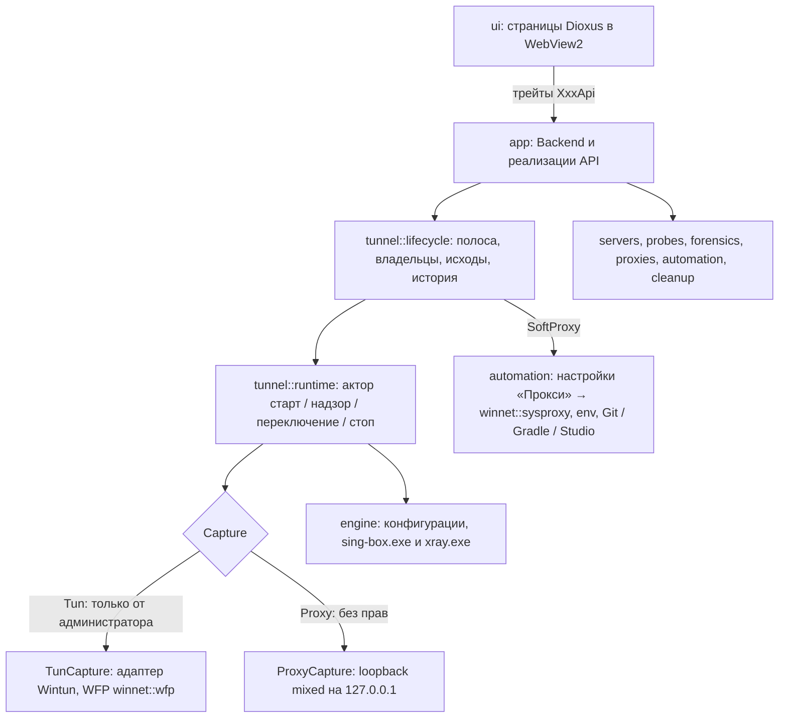

# Архитектура VPN Tunnel Enforcer 2.0 (Rust)

Стартовая точка для ревью и разработки рабочего пространства `vpn-tunnel-enforcer/` (состояние на 12.11.2026).
Решения продукта, слои и правила — `crates/CONTRACT.md`; публичный API крейта — `crates/<имя>/API.md`;
журналы пакетов — `crates/<имя>/progress/`.

## Маршрут чтения

1. `crates/CONTRACT.md` — решения продукта и правила для всех крейтов.
2. [Карта крейтов](./module-map.md) — слои, зависимости, где какой модуль.
3. [Маршрут ревью](./review-guide.md) — что проверять и какие инварианты не ломать.
4. `crates/app/SERVICES.md` — как `app` связывает интерфейс с бэкендом, порядок запуска и остановки.
5. `API.md` нужного крейта, затем его `src/`.

## Один процесс

Интерфейс и бэкенд живут в одном процессе `VPN Tunnel Enforcer.exe` (манифест `asInvoker`). Крейт `ui`
бэкенд не вызывает: каждая страница объявляет view-модели и трейт `XxxApi` (`DashboardApi`, `ServersApi`,
`SettingsApi`, `TrayApi` и др.), а `app` реализует их над общим `Arc<Backend>` и кладёт в контекст Dioxus.
Дочерние процессы — только движки (`sing-box.exe`, `xray.exe`), `curl.exe` для проб утечек через адаптер и
`pktmon.exe` для захвата пакетов; все под Job Object с kill-on-close, конфигурация — через stdin.

## Подключение по шагам

1. UI: «Подключить» → `DashboardApi::connect` в `app`; `svc_tunnel::decide::connect_target` выбирает цель по
   источнику (сервер из списка или локальный прокси вроде Happ) и `routing_mode` (`Hard` → TUN, `Soft` → прокси).
2. `tunnel::lifecycle`: полоса решает, кто вправе менять туннель (`Owner` по приоритету), и превращает цель в
   `StartRequest` с `CaptureKind::Tun` или `CaptureKind::Proxy` и уровнем kill switch.
3. `tunnel::runtime` (актор): `Capture::prepare` → конфигурация sing-box (`profiles::emit_singbox` +
   `engine::singbox_config`; Xray-слоты — `engine::xray_config`) → запуск движков → готовность →
   `Capture::begin` / `ready`. TUN: WFP-защита уровня kill switch и проверка адаптера; прокси: порт `mixed`
   принимает соединения.
4. В «Прокси» lifecycle применяет системный прокси через `SoftProxy` и считывает его обратно: «подключено»
   только при обоих доказательствах. Затем — уведомление и строка истории подключений.
5. Надзор: сторож процесса и выхода, перезапуск с паузами 2/5/10 с, переход на соседний сервер; остановка и
   выход из приложения откатывают захват и настройки.

Без прав `RuntimeDeps::tun = None`: старт «Туннеля» отвечает `Permission` сразу, без молчаливого перехода в
«Прокси». Служба-помощник (`vpnte-service`) в этой фазе не создана.

## Главные инварианты

- Ничто не повышает права и не вызывает UAC; привилегированное отвечает `ErrorKind::Permission`, а UI
  показывает функцию недоступной, а не работающей.
- Состояние «подключено» и любой успех — только наблюдённые; «не проверено» — отдельное состояние.
- Ключи, UUID, пароли и ссылки подписок не пишутся в логи, на диск открытым текстом (только DPAPI) и в
  архив диагностики.
- Конфигурацию sing-box строит только `profiles::emit_singbox`, Xray — только `engine::xray_config`.
- У изменяемого общего состояния один владелец (актор: `mpsc` / `watch` / `broadcast`) или короткая
  блокировка `parking_lot`, не удерживаемая через `.await`.
- Текст для пользователя — только ключи `Msg` с переводами ru и en; логи — на английском.
- Тесты не слушают адреса вне loopback; `elevated_*` и `system_*` запускает только CI.
